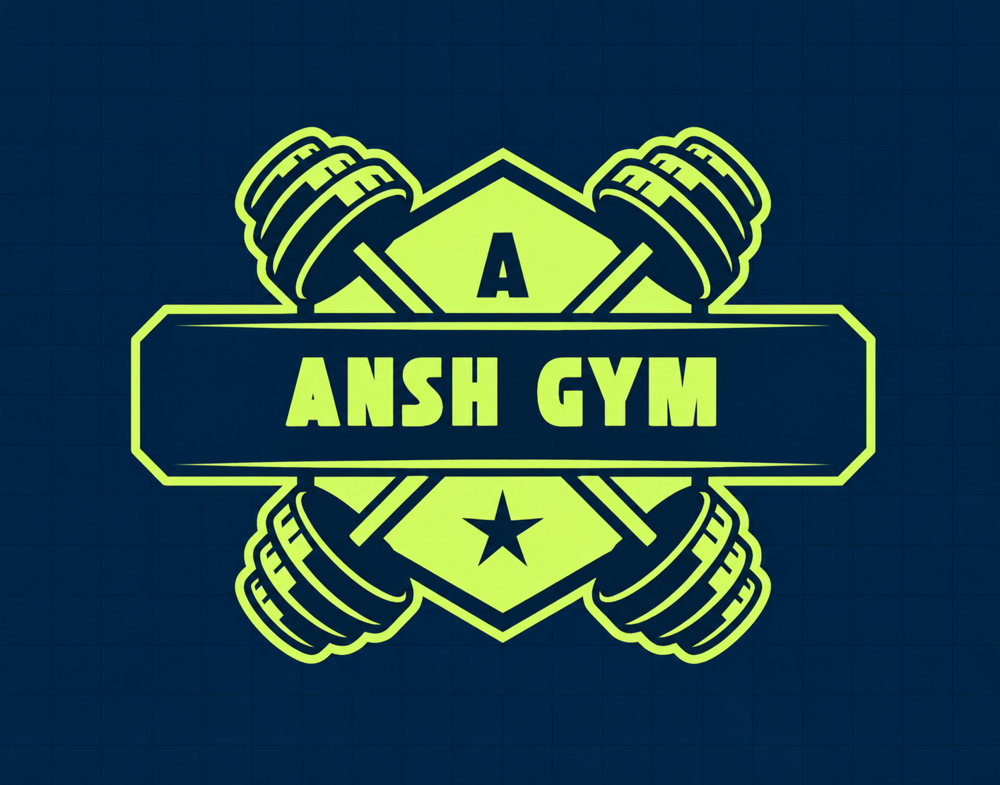

# Ans (अंस) — Offline-First Mobile Fitness Application

<p align="center">
  
</p>

<p align="center">
  <strong>Utilitarian, human-crafted, offline-first mobile fitness tracker for Android.</strong><br>
  Built with Kotlin, Jetpack Compose, Material 3, and a zero-network local SQLite persistence engine.
</p>

---

## Table of Contents
1. [Overview & Philosophy](#overview--philosophy)
2. [Key Architecture & Features](#key-architecture--features)
   - [Static Splash Screen & Asset Binding](#1-static-splash-screen--asset-binding)
   - [First-Time Launch Onboarding](#2-first-time-launch-onboarding)
   - [Navigation Shell & Mode Switch](#3-navigation-shell--mode-switch)
   - [Tab 1: Home](#4-tab-1-home)
   - [Active Workout Flow & 30-Second Cooldown Catch](#5-active-workout-flow--30-second-cooldown-catch)
   - [Tab 2: Track & Water History](#6-tab-2-track--water-history)
   - [Tab 3: Profile & 7-Day Routine Builder](#7-tab-3-profile--7-day-routine-builder)
3. [Pre-loaded Exercise Catalog](#pre-loaded-exercise-catalog)
4. [Design & Technical Constraints](#design--technical-constraints)
5. [Tech Stack & Architecture](#tech-stack--architecture)
6. [Compilation & APK Artifacts](#compilation--apk-artifacts)
7. [Automated Verification & Unit Tests](#automated-verification--unit-tests)

---

## Overview & Philosophy

**Ans (अंस)** is engineered around the principle of focused physical training without digital distraction:
* **No AI Bloat / No Decorative Gimmicks:** Strict high-contrast, flat minimalist layouts. Zero cyberpunk gradients, glassmorphism, or unrequested widgets.
* **Zero Pre-filled / Mock Data:** The application initializes with an empty local SQLite database. Graphs, personal records (PRs), water logs, and streaks start at `0` and populate strictly from real athlete input.
* **100% Offline-First:** Every byte of data is stored securely in on-device SQLite tables and shared preferences. Zero internet connection or external server is required.

---

## Key Architecture & Features

### 1. Static Splash Screen & Asset Binding
* Displays the local `logo.png` / `ans_logo.png` centered on a solid `#0D1117` background.
* **Zero Animation:** Logo is completely static with no rotation, bounce, or scale effects.
* Holds for exactly **5000ms (5 seconds)** via a coroutine timer before navigating to **First-Time Onboarding** (on first launch) or the **Home Tab** (on subsequent launches).

### 2. First-Time Launch Onboarding
Triggered only when the local user profile is uninitialized (`null`). It captures three mandatory inputs:
1. **Weight** (in kg)
2. **Height** (in cm)
3. **Reason for using this app** (Selectable options: *To Lose Weight*, *To Gain Muscle*, *For Athlete / Cycling / Sports Performance*).
* Automatically calculates initial Body Mass Index ($\text{BMI} = \frac{\text{weight}_{\text{kg}}}{(\text{height}_{\text{m}})^2}$), stores it in local preferences, logs the baseline weight point into the SQLite weight table, and routes directly to the main app shell.

### 3. Navigation Shell & Mode Switch
* **Top Bar (Visible on Home):**
  * **Left:** Static "Ans" logo thumbnail and app branding.
  * **Right:** **Mode Switch Toggle** (**Home Mode** vs. **Gym Mode**). Switching modes dynamically filters all active exercises between Home bodyweight/calisthenics workouts and Gym machine/free-weight workouts.
* **Bottom Navigation Bar (3 Tabs Only):**
  1. **Home** (Initial landing tab — strictly titled Home)
  2. **Track**
  3. **Profile**

---

### 4. Tab 1: Home
1. **Workout Streak Tracker (Top Section):**
   * Shows continuous workout days completed and upcoming scheduled days in a clean horizontal streak/calendar strip spanning the current week (Monday to Sunday).
   * Displays the current continuous active streak count (e.g., `0 DAY STREAK` or `3 DAY STREAK`).
2. **Today's Workout Card (Middle Section):**
   * Displays the current day's assigned muscle groups (e.g., *Monday: Chest & Biceps*).
   * Lists the specific exercises filtered by the active Mode (Home vs. Gym).
   * If today is designated as a Rest Day, displays a dedicated recovery card (*Rest & Recovery: Muscles are regenerating today*).
   * Prominently displays the **"Start Workout"** action button.
3. **Achievements Section (Bottom Section):**
   * Displays personal record (PR) max weight lifted for exercises (e.g., *Bench Press - Highest Weight: 85.0 kg*).
   * Starts empty (`0 PRs Logged`) until verified lifts are recorded in active workouts.

---

### 5. Active Workout Flow & 30-Second Cooldown Catch

Triggered via **"Start Workout"**:

#### Page 1: Workout Overview
* Displays the complete list of scheduled exercises for today.
* Shows real-time progress toward the **50% Streak Requirement**:
  $$\text{Completion Ratio} = \frac{\text{Completed Exercises}}{\text{Total Scheduled Exercises}}$$
* **50% Streak Completion Rule:**
  * If the user completes **$\ge 50\%$** of today's total scheduled exercises (e.g., 2 Chest + 1 Bicep out of 6 total $= 50\%$), today is marked as a **Completed Workout Day** and the continuous streak increments.
  * If **$< 50\%$**, today does not count toward the streak.

#### Page 2: Exercise Execution Screen
* **Top Half (Muscle Glow Preview):**
  * Clean 2D anatomical human body SVG/Canvas diagram.
  * Dynamically highlights and glows the active target muscle group in athletic high-contrast burnt orange (`#FF5722`) with a distinct stroke border (Chest, Biceps, Back, Shoulders, Triceps, Legs, Core). Static glow, zero 3D animations.
* **Bottom Half (Set Logger):**
  * Lists individual sets (Set 1, Set 2, Set 3) with target reps (or time duration for holds like Plank) and an editable weight input (in kg).
  * **Mandatory 30-Second Cooldown Catch:**
    * When the user taps **"Done"** on Set 1, all subsequent "Done" buttons are immediately locked for **30 seconds**.
    * A live countdown timer (`00:30` down to `00:00`) is displayed across the interface and inside the locked buttons, preventing accidental double-taps.

---

### 6. Tab 2: Track & Water History

1. **Unified Weight & BMI Graph:**
   * Clean line/area chart plotting the user's logged Weight and calculated BMI over time (starts empty until the user logs their first entry).
   * Visually renders the **Healthy BMI Reference Band (18.5 – 24.9)** directly on the chart canvas with shaded boundaries and reference lines so athletes can see where their BMI belongs.
   * Includes a simple **"Log New Weight Entry"** modal to record new weigh-ins with instant live BMI recalculation.
2. **Daily Water Intake & History:**
   * Displays today's hydration counter in glasses and total volume (ml) with a quick `+` button (+250 ml per glass).
   * **Click Action:** Tapping anywhere on the Water card opens the dedicated **Water History Page**, displaying date-wise historical water consumption logs.

---

### 7. Tab 3: Profile & 7-Day Routine Builder

1. **User Identity:**
   * Editable athlete name.
   * Profile photo picker integrated directly with the device's local photo gallery via Android's `ActivityResultContracts.GetContent()`.
   * Live metric chips: Weight, Height, BMI, and Goal.
2. **Add Custom Exercise:**
   * Ability to append brand new exercises to the local master catalog (specifying Name, Target Muscle Group, Home/Gym mode, and Reps vs. Time based).
3. **Set Rest Days:**
   * Weekly recovery scheduler.
   * **Hard Validation Rule:** The user **MUST** select at least 1 (one or more) rest days per week. The "Save Rest Days" action is strictly disabled and blocked if 0 rest days are selected.
4. **Manage Exercises (Weekly Routine Builder):**
   * Dedicated 7-day planner listing *Monday, Tuesday, Wednesday, Thursday, Friday, Saturday, Sunday*.
   * **Rest Day Behavior:** Days marked as Rest Days appear blank/disabled with a `REST` badge. Clicking a Rest Day does nothing (unclickable).
   * **Active Day Behavior:** Clicking an active day opens that day's routine configuration:
     * User can toggle target muscle group combinations (e.g. switch Monday from *Chest + Biceps* to *Legs*).
     * Switching a muscle group auto-populates the default exercises for that group based on current Home/Gym mode.
     * Each exercise row includes a **`-` (Minus)** button to remove that specific movement.
     * Bottom of list features a **`+ Add New Exercise` (Plus)** button to append movements from the catalog.
   * **Persistence:** This schedule repeats automatically every week and month until modified.

---

## Pre-loaded Exercise Catalog

The seed database initializes the read-only catalog with standard movements mapped to anatomical muscle groups:

| Muscle Group | Gym Mode | Home Mode |
| :--- | :--- | :--- |
| **Chest** | Bench Press, Incline Dumbbell Press, Chest Fly Machine | Push-ups, Wide Push-ups, Decline Push-ups |
| **Biceps** | Barbell Curl, Hammer Curl, Preacher Curl Machine | Chin-ups, Resistance/Towel Curl, Diamond Push-ups |
| **Back** | Lat Pulldown, Seated Cable Row, Deadlift | Pull-ups, Superman Hold (time-based), Inverted Rows |
| **Shoulders** | Overhead Press, Lateral Raises, Shoulder Press Machine | Pike Push-ups, Plank Shoulder Taps |
| **Triceps** | Tricep Rope Pushdown, Skull Crushers | Bench/Chair Dips, Close-Grip Push-ups |
| **Legs** | Barbell Squat, Leg Press, Leg Extension, Hamstring Curl | Bodyweight Squats, Bulgarian Split Squats, Lunges, Calf Raises |
| **Core** | Cable Crunch | Plank (Time-based), Crunches, Leg Raises |

---

## Design & Technical Constraints

* **Theme:** High-contrast dark utilitarian palette:
  * Background: `#0D1117`
  * Card Surfaces: `#161B22`
  * Borders: `#30363D`
  * Primary Accent: `#FF5722` (Burnt athletic orange)
  * Success / Healthy BMI: `#2EA043`
* **Zero AI Bloat:** No unnecessary tabs, social feeds, macro calculators, or decorative noise.
* **Storage Engine:** SQLite via `AnsDatabaseHelper` with tables for `weights`, `water_logs`, `personal_records`, `completed_days`, `day_routines`, and `custom_exercises`.

---

## Tech Stack & Architecture

```
com.ans.fitness
├── MainActivity.kt
├── data
│   ├── local
│   │   ├── AnsDatabaseHelper.kt    # SQLiteOpenHelper for offline persistence
│   │   └── AnsPreferences.kt       # SharedPreferences for onboarding & profile
│   ├── model
│   │   ├── FitnessModels.kt        # Domain models (UserProfile, WorkoutSet, etc.)
│   │   ├── MuscleGroup.kt          # 7 Core anatomical muscle groups
│   │   ├── PreloadedCatalog.kt     # Hardcoded seed exercises
│   │   └── WorkoutMode.kt          # HOME vs GYM mode enum
│   └── repository
│       └── FitnessRepository.kt    # Single source of truth repository
└── ui
    ├── components
    │   ├── AnsBars.kt              # TopBar with logo & mode toggle, BottomBar (3 tabs)
    │   ├── MuscleBodyDiagram.kt    # 2D anatomical SVG/Canvas with target muscle glow
    │   └── UnifiedWeightBmiChart.kt# Weight & BMI chart with 18.5 - 24.9 healthy band
    ├── navigation
    │   └── AppNavigation.kt        # NavHost routing & shell composition
    ├── screens
    │   ├── home/HomeScreen.kt
    │   ├── onboarding/OnboardingScreen.kt
    │   ├── profile
    │   │   ├── AddCustomExerciseDialog.kt
    │   │   ├── DayRoutineEditScreen.kt
    │   │   ├── ManageExercisesScreen.kt
    │   │   ├── ProfileScreen.kt
    │   │   └── SetRestDaysDialog.kt
    │   ├── splash/SplashScreen.kt
    │   ├── track
    │   │   ├── TrackScreen.kt
    │   │   └── WaterHistoryScreen.kt
    │   └── workout
    │       ├── ExerciseExecutionScreen.kt
    │       └── WorkoutOverviewScreen.kt
    └── theme
        ├── Color.kt
        ├── Theme.kt
        └── Type.kt
```

---

## Compilation & APK Artifacts

### Build System Requirements
* **Gradle:** 8.14.3
* **Android Gradle Plugin (AGP):** 8.7.3
* **Kotlin:** 2.0.21
* **JDK:** OpenJDK 21 LTS
* **Compile / Target SDK:** 35 (Android 15)
* **Min SDK:** 26 (Android 8.0)

### Final Compiled APK Paths
* **Primary Debug Output:**
  ```text
  /Users/prakhar/Downloads/Ansh_02/app/build/outputs/apk/debug/app-debug.apk
  ```
* **Convenience Root Copy:**
  ```text
  /Users/prakhar/Downloads/Ansh_02/ans.apk
  ```

### Build Commands
To assemble a fresh APK binary from the project root:
```bash
JAVA_HOME=/opt/homebrew/opt/openjdk@21 ./gradlew assembleDebug
```

To install directly to a connected Android device or emulator:
```bash
adb install -r ans.apk
```

---

## Automated Verification & Unit Tests

The codebase includes an automated test suite verifying state, calculations, and constraints:

```bash
JAVA_HOME=/opt/homebrew/opt/openjdk@21 ./gradlew test
```

### Verified Test Cases (`FitnessLogicTest.kt`):
1. **`loop1_testLocalLogoExistsInRootAndDrawable`**: Confirms logo binding in root and Android drawable directories.
2. **`loop1_testBmiCalculationOnboarding`**: Verifies mathematical BMI formula ($\text{kg} / \text{m}^2$).
3. **`loop1_testZeroPreloadedUserData`**: Asserts zero demo/mock logs on initial app launch.
4. **`loop2_testModeFiltering`**: Asserts correct isolation of Gym vs. Home exercises for each muscle group.
5. **`loop2_test50PercentStreakCompletionRule`**: Validates strict $\ge 50\%$ rule triggers streak increment while $< 50\%$ does not.
6. **`loop3_testHealthyBmiReferenceBandRange`**: Validates classification boundaries for normal (18.5 – 24.9), underweight, and overweight.
7. **`loop3_testWaterIncrementVolume`**: Validates $+250\text{ ml}$ per glass calculation.
8. **`loop4_testRestDaysHardValidationRule`**: Asserts $0$ rest days is rejected by validation and $\ge 1$ is accepted.
9. **`loop4_testCatalogMuscleCoverage`**: Asserts all 7 muscle groups contain both Gym and Home variants.

